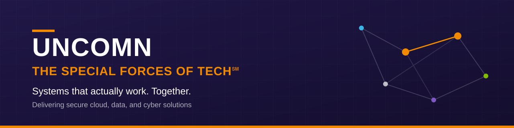

<!--
  UNCOMN organization profile — rendered at https://github.com/UNCOMN-LLC
  Brand: 2023 palette (navy #201747, orange #F18A00, cool gray #54565A), Avenir / Arial.
  Logo: drop the official logo file from the Media library into profile/assets/
  and replace the banner or add it above. Do not recreate the logo. Questions: media@uncomn.com
-->

  

  
  
  

## Keep the Mission Moving

**UNCOMN, the Special Forces of Tech℠, is a management and technology consulting firm that helps mission-critical organizations build systems that actually work together.**

Founded in 2011, UNCOMN serves federal, Department of War, and complex enterprise missions. We deploy small, versatile teams of systems thinkers and engineers who integrate with our clients and focus on the **seams** between systems, teams, data, and vendors — exactly where modernization most often breaks down.

The result: dependable handoffs, less rework, integration proven early, and change that ships cleanly and stays stable in production.

## What We Do

<table>
  <tr>
    <td width="33%" valign="top">
      <h3>🧭 Architecture</h3>
      Enterprise Architecture 
      Mission Thread Architecture 
      Architecture as a Service 
      MBSE as a Service
    </td>
    <td width="33%" valign="top">
      <h3>⚙️ Engineering</h3>
      Systems Engineering 
      Test and Evaluation 
      Digital Engineering and Traceability 
      Integration and Interoperability Engineering
    </td>
    <td width="33%" valign="top">
      <h3>🛡️ Cloud, Data &amp; Cyber</h3>
      Secure Cloud 
      Cyber Operations 
      Trusted Data Solutions 
      DevSecOps and Containerized Runtime Modernization
    </td>
  </tr>
</table>

Also: Interface, Data, and API Governance · Software-as-Code Deployment to the Edge · DoW Strategic Planning and Engagement → [all capabilities](https://uncomn.com/capabilities/)

### Missions We Support

Mission Planning · Transportation and Logistics Technology · Enterprise-wide Data · System-of-Systems Integration · Cyber and Zero Trust Operations · Coalition and Joint Interoperability → [missions](https://uncomn.com/missions/)

## How We Work

Mission outcomes depend on the seams. Modernization fails when architecture, data, interfaces, and delivery paths don't carry cleanly from intent to execution. We bring:

- **Practical systems thinking** — treating complex problems as the connected systems they are
- **Mission-thread alignment** — tracing every change back to the mission it serves
- **Early interoperability validation** — proving integration before it becomes rework
- **Traceability** — from requirements to production, end to end
- **Secure delivery** — change that ships cleanly and stays stable

Our people are organized into Communities of Practice: **Enterprise Solutions**, **Data Solutions**, and **Engineering Solutions**.

## Our Values

**love the problem** · **prioritize people** · **be more, do more** · **cultivate beauty** · **celebrate uncommon genius**

## Work With Us

- 🌐 Learn more at **[uncomn.com](https://uncomn.com)**
- 🤝 Partner with us or start a conversation: **[uncomn.com/contact](https://uncomn.com/contact/)**
- 🚀 Join uncommon people doing uncommon work — follow us on **[LinkedIn](https://www.linkedin.com/company/uncomn)**

  <b>UNCOMN, LLC</b> · The Special Forces of Tech℠ · Delivering secure cloud, data, and cyber solutions

